# Sarah-Maude's prototyping website

## Description
This is Sarah-Maude Roy’s coursework repository for CART253. The purpose of this website is to collect, document and present my prototyping work throughout the course. Here, you will find my reflective journal, experimental prototypes and useful links.

## Useful links
* [Reflective Journal](journal.md)
* [Instructions assignment Journal Entry](https://github.com/sarahmaudr/CART253/blob/main/journal.md#2026-09-19)
* [Variables assignment Journal Entry](https://github.com/sarahmaudr/CART253/blob/main/journal.md#2026-09-26)
* [Conditionals assignment Journal Entry](https://github.com/sarahmaudr/CART253/blob/main/journal.md#2026-10-04)
* [Events assignment Journal Entry](https://github.com/sarahmaudr/CART253/blob/main/journal.md#2026-10-18)
* [Functions assignment Journal Entry](https://github.com/sarahmaudr/CART253/blob/main/journal.md#2026-10-25)

## Prototypes
### Pototyping: Instructions assignment
#### The dragonfly
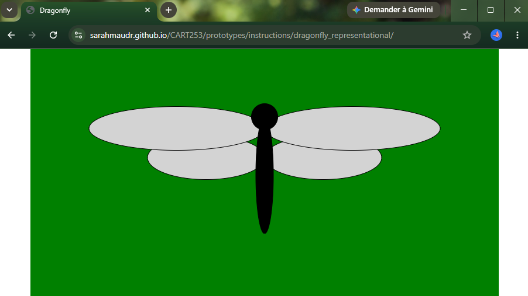
- [Running Prototype](https://sarahmaudr.github.io/CART253/prototypes/instructions/dragonfly_representational/)
- [Code Repository](https://github.com/sarahmaudr/CART253/blob/main/prototypes/instructions/dragonfly_representational/js/script.js)

#### Mirrors
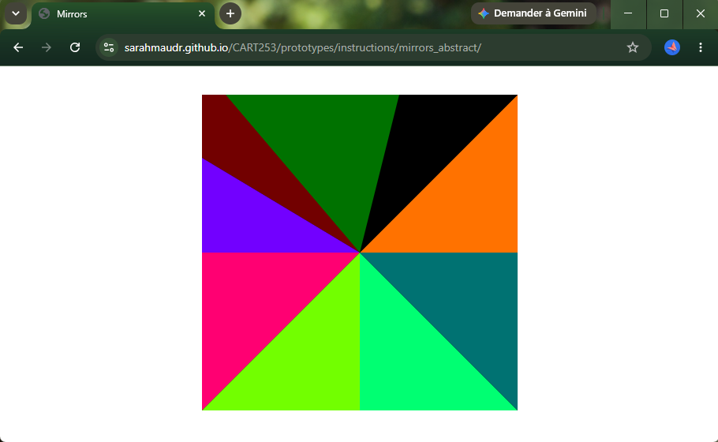
- [Running Prototype](https://sarahmaudr.github.io/CART253/prototypes/instructions/mirrors_abstract)
- [Code Repository](https://github.com/sarahmaudr/CART253/blob/main/prototypes/instructions/mirrors_abstract/js/script.js)

#### Creepy Flower
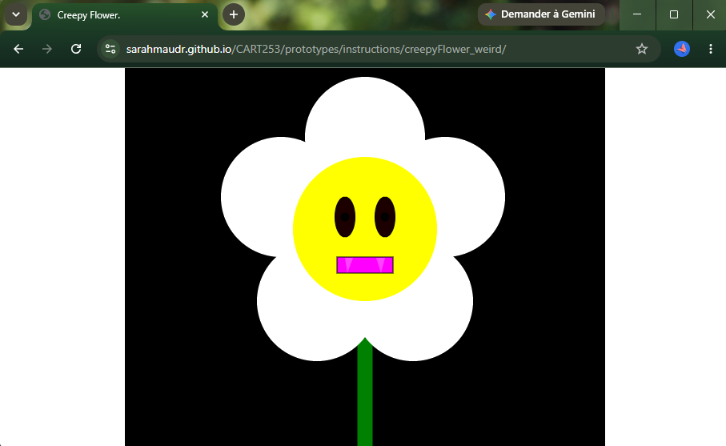
- [Running Prototype](https://sarahmaudr.github.io/CART253/prototypes/instructions/creepyFlower_weird/)
- [Code Repository](https://github.com/sarahmaudr/CART253/blob/main/prototypes/instructions/creepyFlower_weird/js/script.js)

### Prototyping : variables assignment
#### MY HEAD IS ON FIRE !
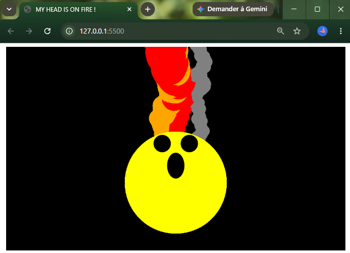
- [Running Prototype](https://sarahmaudr.github.io/CART253/prototypes/variables/variables-prototype-1/)
- [Code Repository](https://github.com/sarahmaudr/CART253/blob/main/prototypes/variables/variables-prototype-1/js/script.js)

#### Nightmare
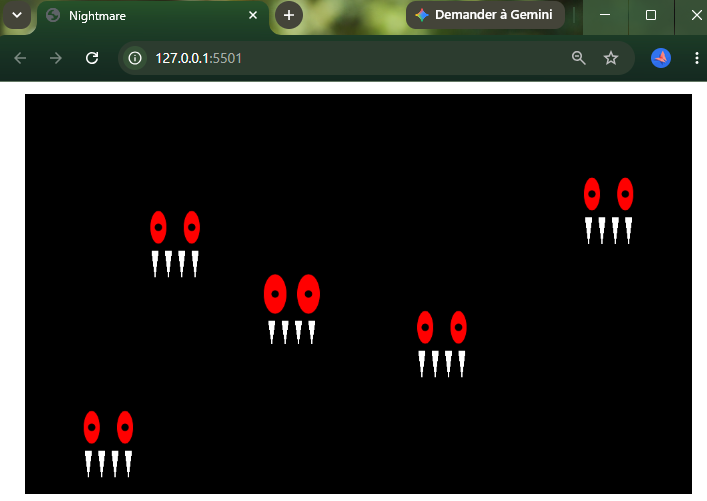
- [Running Prototype](https://sarahmaudr.github.io/CART253/prototypes/variables/variables-prototype-2/)
- [Code Repository](https://github.com/sarahmaudr/CART253/blob/main/prototypes/variables/variables-prototype-2/js/script.js)

#### Celebration !
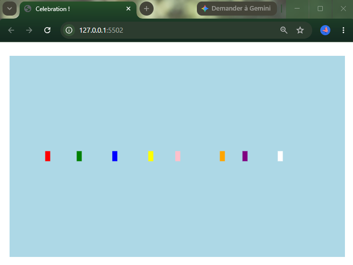
- [Running Prototype](https://sarahmaudr.github.io/CART253/prototypes/variables/variables-prototype-3/)
- [Code Repository](https://github.com/sarahmaudr/CART253/blob/main/prototypes/variables/variables-prototype-3/js/script.js)

### Prototyping : conditionals assignment
#### The Shy Ghost
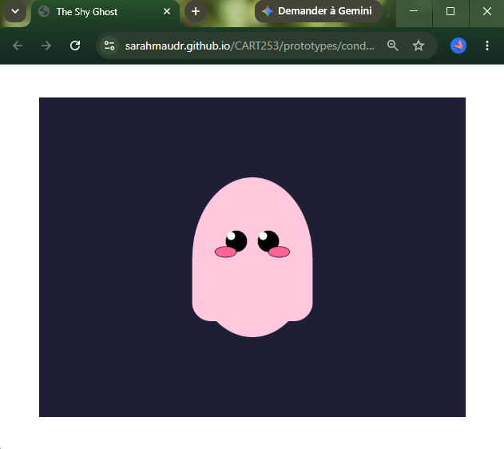
- [Running Prototype](https://sarahmaudr.github.io/CART253/prototypes/conditions/condition-prototype1/)
- [Code Repository](https://github.com/sarahmaudr/CART253/blob/main/prototypes/conditions/condition-prototype1/js/script.js)

#### The disgusted Plant
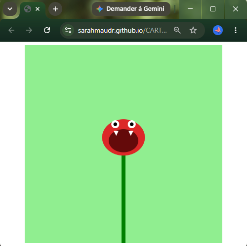
- [Running Prototype](https://sarahmaudr.github.io/CART253/prototypes/conditions/condition-prototype2/)
- [Code Repository](https://github.com/sarahmaudr/CART253/blob/main/prototypes/conditions/condition-prototype2/js/script.js)

#### The eclipse
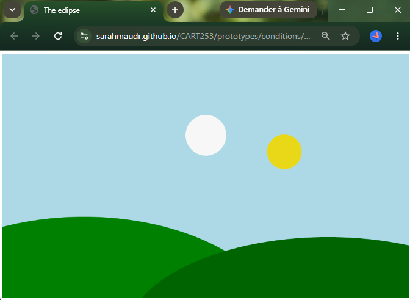
- [Running Prototype](https://sarahmaudr.github.io/CART253/prototypes/conditions/condition-prototype3/)
- [Code Repository](https://github.com/sarahmaudr/CART253/blob/main/prototypes/conditions/condition-prototype3/js/script.js)

### Prototyping : events assignment
#### Lumos!
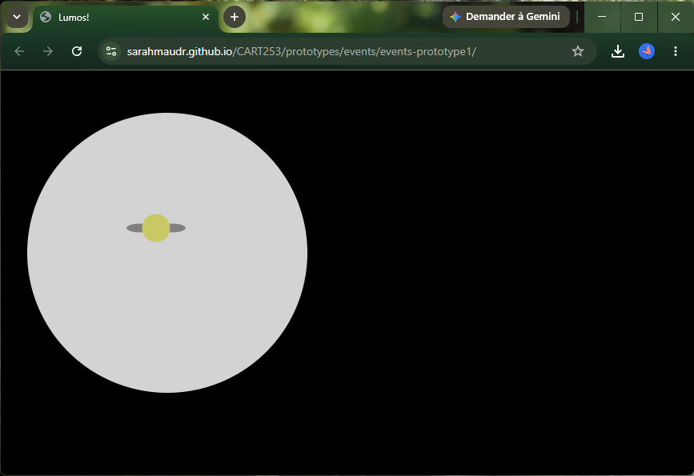
- [Running Prototype](https://sarahmaudr.github.io/CART253/prototypes/events/events-prototype1)
- [Code Repository](https://github.com/sarahmaudr/CART253/blob/main/prototypes/events/events-prototype1/js/script.js)

#### Casting Spells
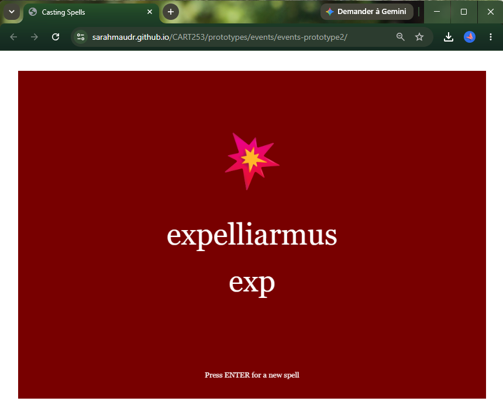
- [Running Prototype](https://sarahmaudr.github.io/CART253/prototypes/events/events-prototype2)
- [Code Repository](https://github.com/sarahmaudr/CART253/blob/main/prototypes/events/events-prototype2/js/script.js)

#### Sorting Hat
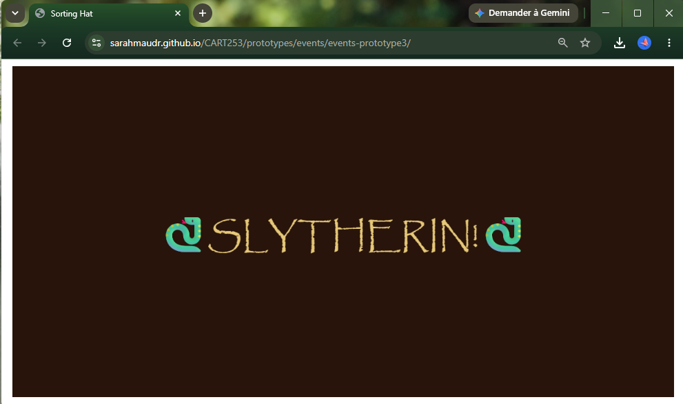
- [Running Prototype](https://sarahmaudr.github.io/CART253/prototypes/events/events-prototype3)
- [Code Repository](https://github.com/sarahmaudr/CART253/blob/main/prototypes/events/events-prototype3/js/script.js)

### Prototyping : Ghosts!!!

[Functions assignment Journal Entry](https://github.com/sarahmaudr/CART253/blob/main/journal.md#2026-10-25)

#### Ghosts!!!
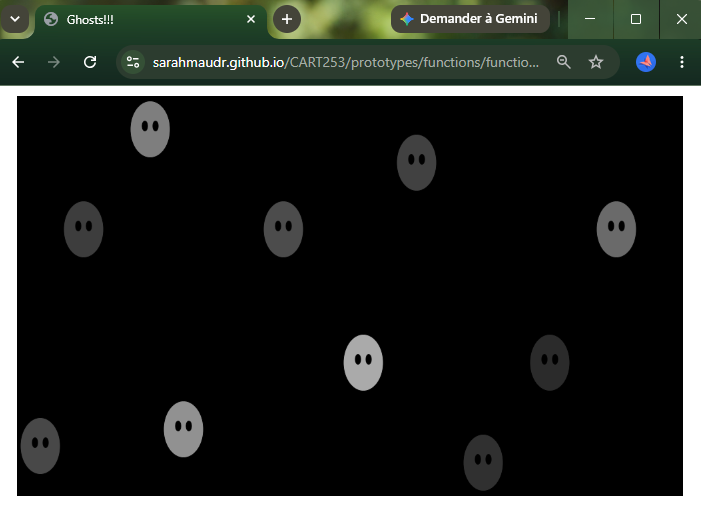
- [Running Prototype](https://sarahmaudr.github.io/CART253/prototypes/functions/functions-prototype1)
- [Code Repository](https://github.com/sarahmaudr/CART253/blob/main/prototypes/functions/functions-prototype1/js/script.js)

#### The Pumpkin
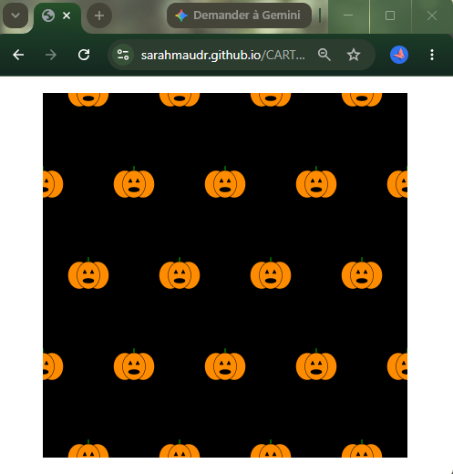
- [Running Prototype](https://sarahmaudr.github.io/CART253/prototypes/functions/functions-prototype2)
- [Code Repository](https://github.com/sarahmaudr/CART253/blob/main/prototypes/function/functions-prototype2/js/script.js)

#### Spooky Messages!
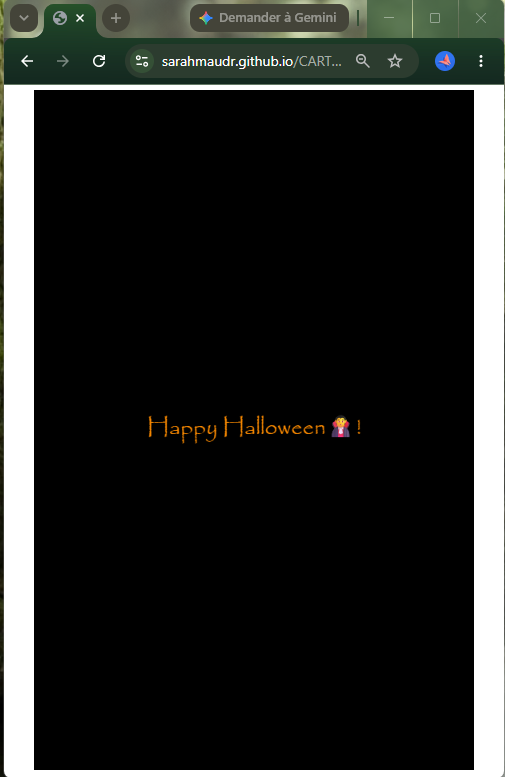
- [Running Prototype](https://sarahmaudr.github.io/CART253/prototypes/functions/functions-prototype3)
- [Code Repository](https://github.com/sarahmaudr/CART253/blob/main/prototypes/functions/functions-prototype3/js/script.js)