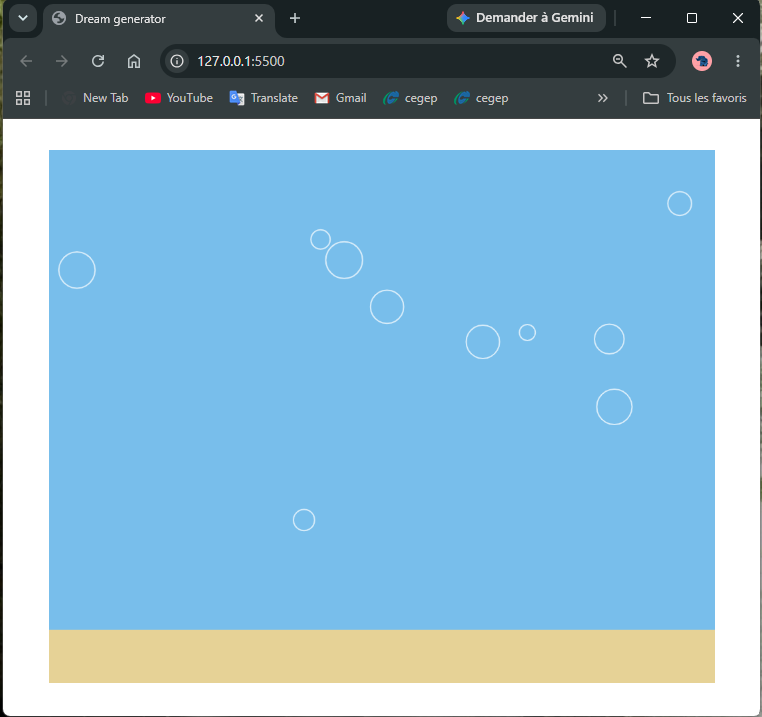

# Dream generator

Sarah-Maude Roy

## Description

Click to generate a random dream, drawn with code. Each dream combines a place, a strange object and a feeling.

- [Running Prototype](https://sarahmaudr.github.io/CART253/prototypes/final)
- [Code Repository](https://github.com/sarahmaudr/CART253/blob/main/prototypes/final/js/script.js)

## Useful links
* [Reflective Journal](journal.md)

## Attribution

> - This project uses [p5.js](https://p5js.org).

## License

> This project is licensed under a Creative Commons Attribution ([CC BY 4.0](https://creativecommons.org/licenses/by/4.0/deed.en)) license with the exception of libraries and other components with their own licenses.

