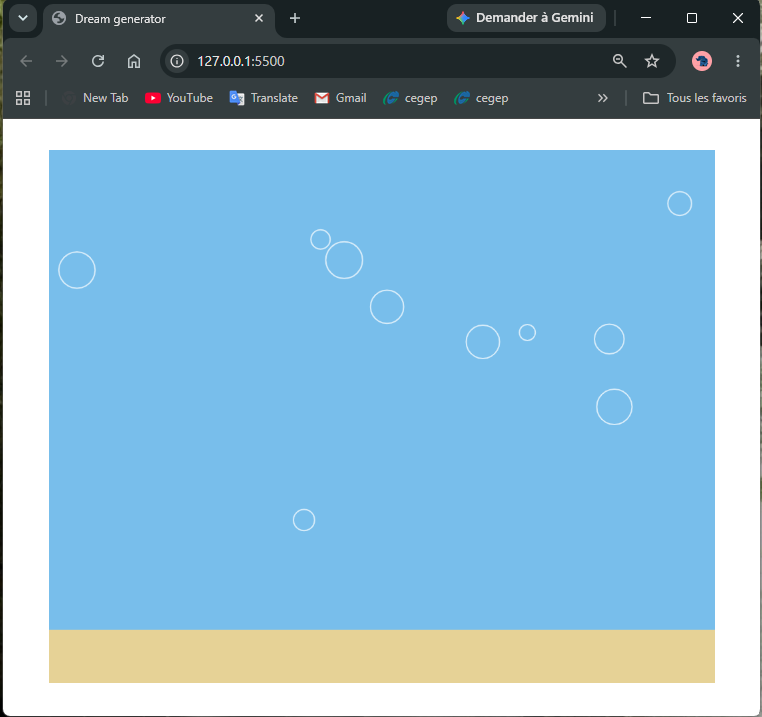
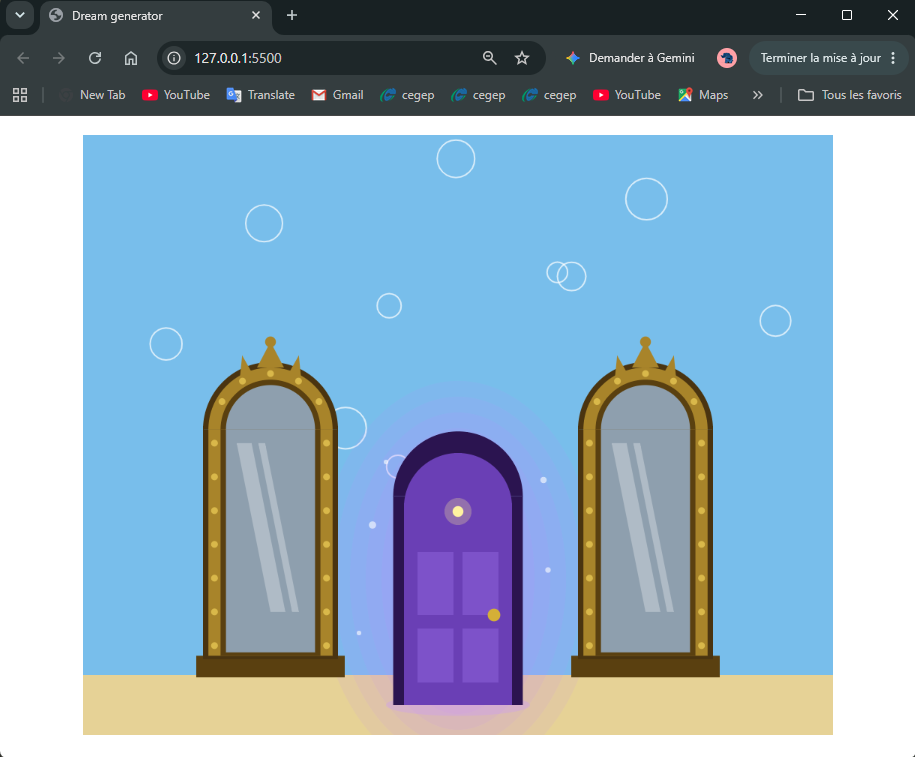

# Reflective Journal

## Week 1
This week I chose my final project idea and built the first working version. I spent a lot of time deciding. At first I thought about a Christmas game, then music and orchestra ideas, then fantasy movies. I looked at ideas like a conductor game, a tuning game and a Fantasia-style world. What I realised is that I wanted something more atmospheric and artistic than a game with a score. I decided on a dream generator: every click creates a new random dream made of a place, a strange object and a feeling.

The design idea is that a few simple pieces of data can create many different moods. Each dream picks one location (above the clouds, an enchanted forest, deep beneath the ocean), one object (a flying whale, a golden door, a mysterious mirror) and one feeling (wonder, mystery, fear and others). With 3 locations, 6 objects and 6 feelings there are 108 combinations, and I want each one to look and feel different. Nothing will be a premade image. Everything is drawn with p5.js shapes, like the reindeer in my arrays prototype.

The biggest technical part so far was the JSON file. My first version only stored names and color words like “lightPink”. I changed it so each location, object and feeling is its own object with extra information. A location has a type and a background color as numbers. An object has a shape name. A feeling has a tint color and a number of sparkles. This was a good lesson in how data and code work together. The code does not hard-code anything about the whale or the forest. It reads the name from the JSON and decides what to draw. If I want a new dream element, I mostly edit the JSON.

I used the async and await style we learned in class: an async preload() that loads the JSON, and an async setup() that waits for it before generating the first dream. That means the data is ready before draw() runs, so I didn’t need extra checks for missing data.

I ran into several bugs. First, the program crashed because draw() called functions I hadn’t written yet, like drawLocation() and drawObject(). Building step by step fixed that: I commented those calls out and turned each one back on once its function existed. Second, nothing showed up even after I added the clouds. The problem was in generateDream(). I created the decor and sparks arrays, but I never put them into the currentDream object, so drawLocation() tried to loop over something that did not exist. I also picked the feeling twice, which would have made the sparkle count not match the feeling. That helped me understand that creating a variable does not mean the rest of the program can see it. It has to be stored somewhere the other functions can reach.

Something I found interesting is that the clouds, trees and bubbles are all the same array of random positions, drawn differently depending on the location. It reminds me of my snowflake array, where one array of objects produced a whole effect.

What I find difficult is the long chain of else if statements and the brackets. One misplaced bracket breaks the whole file, and the error messages are hard to read at first. Using the console helped a lot.

Right now, the background color changes and clouds appear in the pink dreams. Next I want to finish the forest and ocean scenes, draw the six objects, add the feeling tint and sparkles, and then the text description. I’d also like to add small touches like movement.

I hope someone playing it will feel curious and calm, and want to keep clicking to see what the next dream is.

## Week 2
This week I worked on drawing the objects and adding a permanent magical door to the scene. Last week the program could already pick a location, an object and a feeling from the JSON file. This week I made the objects actually appear on the canvas.

I decided to draw every object with basic shapes only: ellipse, rect, triangle, arc and line. The whale is a big ellipse body with a smaller ellipse toward the tail, two triangles for the tail, a lighter belly made with arc, a flipper and a small water spout. I also drew a grandfather clock, a full moon with dark craters, a butterfly, and an old mirror inspired by the Mirror of Erised from Harry Potter.

I replaced the stairs with the moon. A door and stairs both suggest "going somewhere", so they competed with each other. I also wanted a key, but I decided to keep it for later, because I plan to make it hide on the screen so the user has to find it and drag it onto the door to unlock it. That is not built yet.

The door is in its own drawDoor() function, outside drawObject(), so it is always on screen. It is purple with a glowing star and sparkles that pulse using sin(frameCount). I made it bigger and centered, with translate() and scale().

The mirror was the most interesting part. I wanted two tall mirrors, one on each side of the door, but only when the object is a mirror. I remembered that I don't have to write the code twice. I wrote one function, drawMirror(x, y, s), with the position and size as parameters, and I call it twice. I also changed the mirror from an oval to an old one with a dark gold frame.

I ran into a few bugs. My first whale didn't show because I used translate() twice, once in draw() and once inside the object, and the two added up and pushed it off the canvas. And my side mirrors didn't float like the other objects, because I had drawn them outside the translate() in draw(). I fixed that by calling them from inside drawObject().

What I find difficult is keeping track of where the origin is after each translate(). Using push() and pop() helps, but I still have to think carefully about which coordinates I'm using.

Next, I want to build the hidden key.

## Week 3

## Week 4

